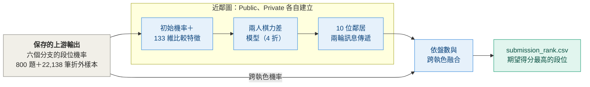

# AI CUP 2026 圍棋競賽｜從棋譜預測棋力

給定一位匿名玩家的 5–20 盤 19 路圍棋棋譜，預測他屬於 D、C、B、A、1D–6D 十個段位中的哪一個。最終方法先用多個上游模型估計每位玩家的段位機率，再把同一題池裡的匿名玩家連成近鄰圖。圖中鄰居之間的相對棋力差，用來修正每個人的段位機率。

| 隊伍 | Private 分數 | Private 名次 | Public 分數 |
|---|---:|---:|---:|
| TEAM_10892 | **0.7690426** | **第 10 名／175 隊** | 0.7785244 |

本 repo 可從保存的上游輸出重新算出比賽提交檔，並與原檔逐位元比對（SHA-256 `84861fd9…ca814`）。只用 CPU，約 10 秒完成。步驟見[重現提交檔](#重現提交檔)。

## 目錄

- [任務](#任務)
- [方法總覽](#方法總覽)
- [開發歷程](#開發歷程)
- [驗證與選檔](#驗證與選檔)
- [重現提交檔](#重現提交檔)
- [重現範圍](#重現範圍)
- [Repo 結構](#repo-結構)
- [資料與外部資源](#資料與外部資源)
- [授權](#授權)

## 任務

AI CUP 2026 圍棋競賽的子任務二。
- **資料**：日本棋院幽玄之間 2021–2023 年的匿名棋譜。訓練集共 100 萬盤、8,007 位玩家，每個段位 10 萬盤，每位玩家只屬於一個段位。
- **題目**：Public 與 Private 各 400 題。每題提供同一位玩家、相同執色的 5、10、15 或 20 盤棋，四種盤數各 100 題。
- **計分**：段位完全正確得 1 分，差一級得 1/e ≈ 0.368 分，其餘 0 分。

## 方法總覽



灰色是比賽期間產生、本 repo 保存的上游輸出；藍色是本 repo 重新計算的步驟；綠色是最終提交檔。

1. **上游分支**：
   - 比賽期間用官方棋譜、HumanSL 逐手機率、KataGo 局面特徵與 Fox 預訓練模型，訓練出六個分支，分別估計每題玩家的段位機率。
   - 訓練集依玩家分折，產生 22,138 筆折外機率。本 repo 保存這些輸出。
2. **初始機率**：以對手分支為主，加上棋譜指紋相對歷史棋力的對數機率修正。
3. **兩人棋力差模型**：
   - 輸入兩位玩家的 133 維比較特徵，輸出 19 種段位差的對數似然修正。
   - 用折外樣本依玩家分 4 折訓練，每折各一個模型。
4. **近鄰圖與訊息傳遞**：
   - Public、Private 各自在 400 題內建圖，每位匿名玩家取 10 位最可比較的鄰居。距離依預期段位差、機率分布距離、特徵差異與盤數計算。
   - 兩人模型的段位差證據經兩輪訊息傳遞後，以強度 1.25 更新初始機率。
5. **盤數融合與決策**：
   - 圖模型和跨執色模型依盤數做對數機率融合。5／10／15／20 盤時，圖模型的權重約為 0.994／0.992／0.926／0.692。
   - 最後取期望得分 `p[k] + (p[k−1] + p[k+1]) / e` 最高的段位。

各步驟的公式與超參數見 [docs/method.md](docs/method.md)。

## 開發歷程

| 時間 | 做法 | Public |
|---|---|---:|
| 11/11 | 官方棋譜 ResNet 基準；加入 KataGo＋HumanSL 特徵 | 0.4776442 → 0.5159729 |
| 11/11 | **7 成分機率融合，含 Fox 27 級預訓練** | **0.6929805** |
| 11/12–13 | TTA、可靠度 gate、前端改寫、CatBoost、依盤數校準 | 都在 ±0.005 內，未上傳 |
| 11/15 | **HumanSL 全手數：雙方每一手 × 11 種棋力設定** | **0.7025790** |
| 11/17–19 | **玩家層級集合模型，每人用 8 → 16 → 24 盤訓練** | 0.7162578 → 0.7427214 |
| 11/19 | 對手配對證據 | 0.7502214 → 0.7552214 |
| 11/20 | **匿名玩家相對棋力近鄰圖（最終提交）** | **0.7785244** |

最重要的經驗是：**資訊量比模型花樣重要**。
- 11/12–13 做了十多個「輸入不變、只換模型或後處理」的實驗，結果全部落在 ±0.005。
- 真正的進展都來自新的資訊來源，依序是：
  - HumanSL 全手數；
  - 每位玩家更多盤數；
  - 對手配對；
  - 同一題池中玩家之間的相對關係。

完整的 16 次上傳紀錄、有效與無效的方法，見 [docs/experiments.md](docs/experiments.md)。

## 驗證與選檔

- **本地題目**：依玩家分組，避免同一位玩家同時出現在訓練與測試折。
- **驗證組**：
  - 早期使用 400 題的歷史驗證組與保留組。
  - 歷史驗證玩家在開發中被反覆使用，後期另外建立 HD≤1 組、fresh114、new72，以及模型鎖定後才評分的 180 人組。
- **選檔**：鎖定時，最終版在五個題組的點估計都高於既有參照，但各組的成對 95% 區間都涵蓋零。

| 本地題組 | 既有參照 | 最終版 |
|---|---:|---:|
| 歷史 validation | 0.78077 | 0.78102 |
| 歷史 holdout | 0.77062 | 0.77919 |
| hd333 | 0.78235 | 0.78884 |
| fresh114 | 0.82306 | 0.83738 |
| new72 | 0.75785 | 0.76662 |

- **鎖定後才評分**：在 180 人組上，最終版 0.76503，既有版本 0.76854。這組數字用來檢查選模偏差。
- **官方結果**：
  - Public 比前一個最佳版本高 +0.0233。
  - 比賽期間估計 Private 約 0.778，95% 範圍 0.74–0.82；實際 Private 0.7690426，落在範圍內。

## 重現提交檔

在 Windows 11、Python 3.11.16、只用 CPU 的環境測試過，從乾淨的 clone 開始，結果與比賽提交檔逐位元相同。

### 1. 取得程式與環境

```shell
git clone https://github.com/leezr2002/aicup2026-go-rank-prediction.git
cd aicup2026-go-rank-prediction
conda env create -f environment.yml
conda activate aicup-go-final
```

### 2. 放入官方競賽資料

本 repo 不散布競賽資料。請把官方提供的 3 個檔案放進 `data/official/rank_prediction/`。檔名和 SHA-256 列在 [data/README.md](data/README.md)。程式會核對雜湊、題號與盤數。

### 3. 驗收

```shell
python -B acceptance.py
```

- `acceptance.py` 分兩個獨立程序執行：先重新推論，再驗證輸出。
  - 推論程序禁止讀取 repo 以外的檔案，也禁止讀取原始提交檔。
  - 驗證程序檢查表頭、題號順序與段位值，最後與 `rank_prediction/submission/submission_rank.csv` 逐列、逐位元比對。

預期輸出（測試機約 11 秒，記憶體峰值約 0.6 GB）：

```text
Wrote 800 predictions to outputs/submission_rank.csv
submission_rank.csv: 800/800 rows and SHA-256 match (84861fd940cbde263d669308d9dcb5a11416fe622a0face181f945e9563ca814)
```

### 選用：重訓兩人棋力差模型

```shell
python -B rank_prediction/scripts/train.py
python -B acceptance.py --trained
```

用保存的 22,138 筆折外樣本和原本的玩家分折，重新訓練四個兩人棋力差模型，再用新權重驗收。亂數種子固定，測試機重訓約 1 分鐘，重訓後的提交檔仍與原檔逐位元相同。

## 重現範圍

- **逐位元重現**：從保存的上游分支輸出開始，包括 800 題的六個分支機率，以及跨執色機率。之後的初始機率、比較特徵、近鄰圖、訊息傳遞、盤數融合與段位決策全部重新計算。
- **可重訓**：四個兩人棋力差模型（CPU）。
- **不在本 repo 範圍**：上游分支模型的訓練程式與完整重訓，包括 HumanSL／KataGo 特徵抽取、玩家層級集合模型和對手配對模型。這些模型在比賽期間由多個實驗產生，本 repo 只保存它們的輸出，所以無法對任意新題目做端到端推論。

## Repo 結構

```text
.
├── README.md
├── environment.yml               Python 3.11 與套件版本
├── acceptance.py                 一鍵重新推論並驗收
├── verify_submission.py          格式、題號、段位值與 SHA-256 檢查
├── data/
│   ├── README.md                 官方資料清單與 SHA-256、外部資源
│   └── official/rank_prediction/ 放官方 CSV（不隨 repo 散布）
├── docs/
│   ├── method.md                 公式、模型架構與超參數
│   └── experiments.md            16 次上傳紀錄、有效／無效方法
└── rank_prediction/
    ├── README.md                 各階段指令與輸入輸出
    ├── config/final.yaml         圖參數、盤數權重、段位順序、官方輸入雜湊
    ├── src/                      輸入建構、兩人模型、近鄰圖、推論
    ├── scripts/                  prepare／train／predict／verify 入口
    ├── artifacts/
    │   ├── branches/training.npz 22,138 筆折外分支機率、段位標籤、玩家分折
    │   ├── branches/official.npz 800 題的上游分支機率
    │   └── weights/              比賽使用的四折模型權重
    ├── submission/submission_rank.csv   比賽提交原檔
    └── outputs/                  執行時產生（不進版本控制）
```

## 資料與外部資源

**官方資料**：由 AI CUP 2026 主辦單位提供，本 repo 不重新散布。

**`artifacts/`**：上游模型的輸出與訓練標籤（段位、匿名玩家代碼、分折），不含任何棋譜內容。

**外部資源**：比賽期間使用以下資源，依競賽規則揭露。

| 資源與版本 | 授權 | 用途 |
|---|---|---|
| KataGo v1.18.2（CUDA 13.2、cuDNN 9.24） | 引擎主體為 [MIT](https://github.com/lightvector/KataGo/blob/v1.18.2/LICENSE)，第三方元件依各自授權 | 棋譜局面分析與上游特徵抽取 |
| KataGo 權重 `kata1-tf3-b11c768-s11001M-d5973M`、HumanSL 權重 `b18c384nbt-humanv0` | [KataGo Neural Network License](https://katagotraining.org/network_license/)（[模型清單](https://katagotraining.org/networks/)、[HumanSL 發布頁](https://github.com/lightvector/KataGo/releases/tag/v1.15.0)） | 一般局面特徵，以及不同棋力設定下的落子機率，經上游模型使用 |
| Fox 圍棋棋譜 [`featurecat/go-dataset`](https://github.com/featurecat/go-dataset/tree/acace506d745d02f35a32249317c15cea28c66a6)，commit `acace506` | 上游資料庫標示 [GPL-3.0](https://github.com/featurecat/go-dataset/blob/master/LICENSE.txt) | 用 Fox 原生 27 級標籤預訓練棋盤模型，經上游分支間接使用 |

本 repo 不包含 KataGo 程式、權重或 Fox 棋譜。`artifacts/` 中有一部分是用上述資源訓練或抽取的模型輸出。

## 授權

本 repo 未附開源授權，保留所有權利。歡迎閱讀程式碼，並依上述步驟驗證比賽結果；其他用途請先取得作者同意。第三方資源依各自的授權條款。
